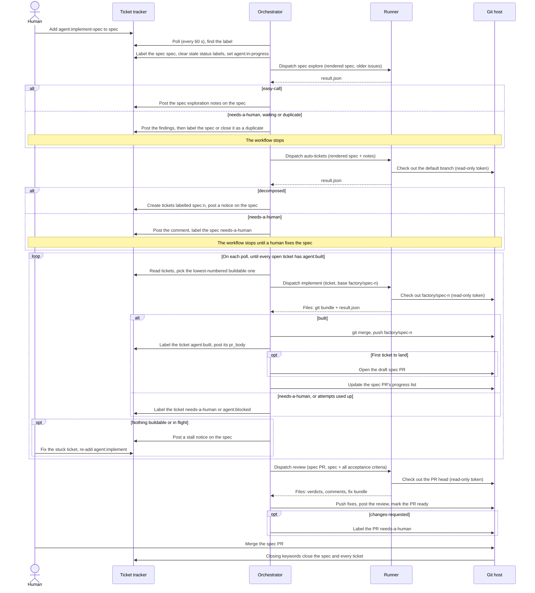

# Software factory: orchestrator

Status: agreed design, not built. This document specifies the orchestrator: the process that polls GitHub for work, queues and dispatches runs, collects and validates their results, chains tasks into workflows, and does all the writing to GitHub. The rest of the factory (the services, the runners, the runner contract, the tasks and enrolling a repo) is in [software-factory.md](software-factory.md), which also defines the terms **task** and **workflow**.

The orchestrator is written in **Python**. Its language is independent of the tasks, which run on the runner in the base image. The only coupling is [the runner contract](software-factory.md#the-runner-contract), which the orchestrator implements one side of.

## Where it runs

On the family Mac mini (M2, 24 GB), which is on most of the time.

- It runs under a dedicated `SWFactory` macOS user, so other non-admin family accounts can't read its secrets.
- launchd starts it at boot and restarts it when it crashes.
- The Mac mini may sleep. Runs happen on the runner, not the Mac mini, so a run in flight keeps going and its files wait on the runner; only new triggers, collecting and the next dispatch wait until it wakes. There's no drain step before sleeping: to stop spending usage, remove trigger labels or stop the launchd job.
- It is managed from the development laptop over SSH, on the home network only. Access from away (e.g. Tailscale) is left for later.
- Its database is copied nightly by `factory backup` (a second launchd job), and Time Machine takes the copies off the machine.

The orchestrator is **one process and one SQLite file**, so moving it to a VM or another machine means copying that file and giving the new machine its own App key.

## State

SQLite holds two central tables, `runs` and `workflows`, and a few small ones the orchestrator needs between passes.

- **`runs`** is the only queue for every task in every repo. **One row is one dispatch**: a retry is a new row, so every branch, runner run and `result.json` maps to exactly one row and nothing is overwritten. Each row has `id, repo, task, ticket, workflow_id, attempt, retry_of, triggered_by, triggered_by_id, status, outcome, runner_run_id, dispatch, result, validation_error, log_url, created_at, dispatched_at, finished_at, handled_at, shown_at, cancel_requested_at`.
  - `ticket` is an opaque string (`"123"` today), not an issue number, here and in `dispatch.schema.json`, so a different tracker's ids fit without a schema change.
  - `status` is the lifecycle: `queued` → `dispatched` → `done`. `outcome` is how a `done` row ended: the contract's `succeeded` or `failed`, or one only the orchestrator can tell: `invalid` (the result failed validation), `timed_out`, `cancelled` or `superseded` (e.g. a review whose branch moved).
  - `triggered_by` is the login of the human who added the trigger label, read from the issue's events when the trigger is found, and `triggered_by_id` their numeric GitHub user id (the label event's `actor.id`). Implement and review dispatches carry both as `triggered_by: {login, id}`, for the commits' `Co-Authored-By:` trailer. A chained run copies them from the run that queued it.
  - `validation_error` says why an `invalid` result was judged invalid; the retry's `previous_attempt` carries it.
  - `log_url` is the runner's log link, stored at dispatch, so the CLI never asks the runner.
  - `handled_at` is when the orchestrator finished acting on a `done` row's result: posting it, chaining the next task, or retrying. A `done` row with none still has work to do. It's set only after the writes succeed, so a failed write is tried again on the next pass (and a crash between a write and setting it can post twice).
  - `shown_at` is when a `done` row's final line went onto its [status comment](#observability).
  - `cancel_requested_at` is when `factory cancel`, or a human closing the run's issue or PR, asked for it to be cancelled. The orchestrator acts on it in its next loop, if the row is still `queued` or `dispatched` (see [Cancelling](#cancelling)).
  - **Claiming a row.** Before asking the runner to start a run, the orchestrator claims the row: it sets it `dispatched`, with no `runner_run_id` yet, only if it's still `queued`. So two processes sharing the file (`factory serve` and `factory doctor`'s smoke run) never dispatch it twice, and a process that loses the claim sends nothing. If the runner can't be reached, the row goes back to `queued`. A claim left by a process that died mid-dispatch (still no `runner_run_id` after 10 minutes) goes back to the queue.
  - `pr_base_sha` isn't a column: review's dispatch carries it, the PR's base commit, so the runner can fetch the diff and restore agent instructions from the base. For a spec PR it's auto-tickets' `base_sha`, where the integration branch started.
  - `dispatch` holds the dispatch inputs (minus the token) and `result` holds `result.json`, both as JSON. Rows are kept forever: a few KB each, so "why did run 412 do that?" can be answered from `factory runs` alone, after the runner's logs expire. The git bundle is used once and not kept, and screenshots stay on the runner as long as it keeps the run's files (7 days on Actions, see below).
- **`workflows`** holds what belongs to a [workflow](#workflows) rather than to one run: `id, repo, kind, subject, branch, pr, status, spec_hash`. `kind` is `implement-ticket`, `implement-spec` or `review-pr` (a findings-only review of a PR the factory didn't open), and `status` is `active`, `done`, `stopped` or `cancelled`. For implement-spec that's the spec, the integration branch, the spec PR, and a hash of the spec's body when it was decomposed (updated on each change, see [Implement-spec](#implement-spec)). For implement-ticket it's the ticket and its PR. The *queue* state (which tickets are blocked or built) stays in the issues; this table holds only what GitHub can't answer cheaply.
- **`repos`** holds each repo's enrolment as last read: one row per repo the App is or was installed on, `repo, state, enrolment_sha, config, error, labels_at, checked_at`. `state` is `enrolled`, `not_enrolled`, `invalid` or `uninstalled`; `config` is the parsed `config.yml` and `error` why it's invalid; `labels_at` is when the factory's labels were created on the repo, so that's done once (see [Enrolments](#enrolments)).
- **`status_comments`** holds each issue's or PR's [status comment](#observability): `repo, number, comment_id, body`. The body is the one last written, so the comment is edited only when it changes.
- **`problems`** holds the [factory problems](#observability): `id, kind, repo, summary, issue, opened_at, closed_at, posted, issue_closed_at`. There's at most one open row per kind and repo (`repo` empty: the whole factory). `issue` is its GitHub issue (`owner/repo#n`), `posted` the summary last written there (a changed summary gets a comment), and `issue_closed_at` when the issue was closed after the problem cleared. Problems closed before `posted` and `issue_closed_at` were added (migration 9) count as closed on GitHub too.
- **`settings`** (key and value: the pause flag, `owner`, when the runner became unavailable and when it last refused a run), **`usage_readings`** (each Claude usage reading, or why it failed) and **`polls`** (each repo's last successful poll) feed the brakes and `factory status`.

A dispatch loop picks the oldest queued run as long as fewer runs are in flight than the limits allow. A retry is a new row, so it goes to the back of the queue.

**Losing the database.** Human intent (labels) and the spec queue (tickets, `## Blocked by`, `agent:built`) live on GitHub. Only in-flight run ids, attempt counts, workflow rows and history live only in SQLite. Losing the file loses history and attempt counts but no work, so a nightly backup is enough. Rebuilding workflow rows after a loss is a manual job.

**Migrations.** A numbered list of SQL steps in the orchestrator's code, tracked with SQLite's `PRAGMA user_version` and run at startup. The orchestrator copies the database file before migrating, so a bad migration is a one-command rollback. There's no migration tool.

## Dispatching and collecting

The orchestrator talks to runners only through the **Runner interface** (see [Keeping the runner swappable](software-factory.md#runners)). It never calls a runner's own APIs or builds its URLs. The interface does five things:

- **dispatch** a run and return the runner's own id for it, stored as `runner_run_id`
- report a run's **state**: running, finished, or missing (the runner has no such run)
- hand over a finished run's **files**: `result.json`, the bundle and any screenshots, or nothing if the run left none
- give a run's **log link**, for status comments and `factory runs`
- **cancel** a run

On startup and on each poll, the orchestrator looks up every `dispatched` row, always asking the runner for the run's state first:

- If the run has finished, it collects the files, however late. After a sleep, many runs are past 60 minutes and finished; they are collected normally.
- If the run is missing, or finished without files, the outcome is `failed`. A runner keeps a run's files for a limited time, so a Mac mini asleep longer than that finds them gone, and the normal attempts rule retries it.
- Only if the run is *still running* 15 minutes past its task's timeout (for queueing and upload; see [Limits and brakes](#limits-and-brakes)), it cancels the run and records `timed_out`. The runner enforces the timeout itself too, so the limit holds even while the orchestrator is down. The limit lives in one place, the orchestrator's config, and travels in the dispatch.

Once it has the files, the orchestrator validates `result.json` and the bundle against [the runner contract](software-factory.md#the-runner-contract), then does all the writing to GitHub. An invalid result counts as a failed attempt, and nothing is written to GitHub. If the orchestrator is offline when a run finishes, the files wait on the runner until the orchestrator collects them.

**Commits that are lost.** If a run finished but its commits can no longer be had (the orchestrator's git store lost them and the runner's files have expired), the run is handled once: a notice on its ticket (a review's: on its PR) says to add the trigger label again, and the ticket (or PR) gets `needs-a-human`. A spec's ticket stops on its own, like any stuck ticket; any other workflow stops. It isn't retried every pass.

**On Actions (v1).** The Actions runner implements the interface like this:

- **Dispatch** uses `workflow_dispatch` with `return_run_details: true`, which makes the API return the Actions run it created (since February 2026). It answers `200` with `workflow_run_id`, `run_url` and `html_url`; `workflow_run_id` is the `runner_run_id`, and `html_url` is the log link. The adapter sends `X-GitHub-Api-Version: 2026-03-10`: the older default, `2022-11-28`, answers with a `Deprecation` header and is sunset on 10 March 2028. The caller workflow's `run-name` ("Factory run <run id>: <task>", in `runner/templates/factory.yml`) includes the factory run id, so a human browsing Actions can match runs to rows. It lives in the caller because Actions ignores a reusable workflow's `run-name`.
- **Files** are the run's artifact. `run.yml` uploads with `retention-days: 7`, which keeps old bundles from piling up and counting against the account's Actions storage.
- **The log link** is the Actions run's page.
- **Timeouts:** `run.yml` sets the job's `timeout-minutes` to the smaller of the dispatch's `timeout_minutes` and 60, as the expression `${{ fromJSON(inputs.dispatch).timeout_minutes > 60 && 60 || fromJSON(inputs.dispatch).timeout_minutes }}` (Actions has no `min()`). The cap guards against a human with write access starting the caller workflow by hand with a huge number. When the job's timeout fires, Actions ends the run with conclusion `cancelled`, not a timeout conclusion, and the job gets the annotation "The job has exceeded the maximum execution time of …". The adapter reads the job's annotations and reports that run as `timed_out`, so it isn't mistaken for a human cancelling it.

**Failures that aren't attempts.** Three `failure` reasons, and an unreachable runner, aren't the ticket's fault, so they don't count as an attempt:

- `contract_mismatch` (the runner got a `contract_version` it doesn't accept): the orchestrator pauses dispatching, logs it once and opens a [factory problem](#observability) issue. The rule is: merge a schema change, then redeploy the orchestrator (see [Deploying](#deploying)).
- `claude_auth` (Claude rejected the token: expired, revoked, or the secret is missing): the orchestrator holds dispatches **for that repo** and opens a [factory problem](#observability) naming it, rather than retrying innocent tickets into `agent:blocked`.
- `usage_limit` (the run hit the Claude usage limit partway through): the orchestrator queues the run again behind the [usage pause](#limits-and-brakes).
- **Runner unavailable** (the runner can't be reached or refuses a dispatch, whatever the cause: an Actions outage, a rejected `workflow_dispatch`, runs refused because the Actions spending limit is reached, a runner machine that's switched off): a run that wasn't dispatched stays `queued`, and a `dispatched` run stays as it is until the runner answers. This is different from a *missing* run, where the runner answers that it has no such run (on Actions, a 404 for the run id). On Actions, a run refused for billing still exists: its job ends without running any step, with the message "The job was not started because recent account payments have failed or your spending limit needs to be increased." The adapter matches that message and reports runner unavailable; the run is put back to `queued` rather than counted as an attempt, and nothing is dispatched for 15 minutes, so the refused run isn't sent again on every poll. This comes from user reports, not GitHub's docs, and couldn't be reproduced without using up the account's included minutes, so the adapter logs the full run and job JSON the first time it sees a job that ran no steps. If the runner stays unavailable for 30 minutes, the orchestrator opens a [factory problem](#observability).

A `result.json` with an unknown version is `invalid`.

## Cancelling

When a human closes a ticket, spec or PR that has active rows, the orchestrator marks its `queued` rows `cancelled`, cancels its `dispatched` runs on the runner and discards their results, and, for a spec, sets its `workflows` row to `cancelled`. The poll checks whether each issue with active rows is still open. Removing a trigger label doesn't cancel anything, because the orchestrator removes it itself once the run is queued (see [Triggers](#triggers)).

`factory cancel <run>` cancels one in-flight run by hand (see [Limits and brakes](#limits-and-brakes)).

**A PR closed while the orchestrator was down or asleep.** The full scan on startup or waking lists only open issues and PRs, so it finds a factory PR closed without merging only while its ticket (or spec) is still open: a missing PR whose ticket is open was closed by hand, while a merged PR closes its ticket. A PR closed while its ticket was closed too is skipped, and its workflow stays as it was; no call is made per closed ticket in the history.

## Triggers

The orchestrator **polls** each enrolled repo about every 60 seconds for trigger labels (`agent:explore`, `agent:implement`, `agent:review`, `agent:implement-spec`).

- Nothing reaches into the home network: there are no webhooks, no public URL and no port forwarding.
- Webhooks are deferred. A one-minute delay doesn't matter next to runs that take up to 45 minutes. The interval is fixed: no faster polling while a run is in flight.
- **One call per repo per poll:** `GET /repos/{owner}/{repo}/issues?state=all&since=<cursor − 2 min>&sort=updated`, sent with the last ETag. It returns issues and PRs, so it finds new trigger labels and closed issues and PRs (for [Cancelling](#cancelling)) in one go. An idle repo answers 304, which doesn't count against the App's rate limit (at least 5,000 requests an hour per installation). Checking `dispatched` rows adds at most one call per run in flight. Adding a label does bump `updated_at` (tested). The list can lag the change by some seconds: a `since` query right after a label was added missed it, and the same query a minute later found it. The 2-minute overlap covers that.
- **Catching up:** the cursor and ETag live in memory. On startup, and on waking (any gap of more than 5 minutes between polls), the orchestrator scans every open issue and PR instead, fetches fresh App tokens and a fresh usage reading, and then resumes the cheap poll. No trigger is lost while it's down or asleep, and the dispatch limits still apply, so a long sleep doesn't cause a burst.
- **Errors:** each repo has its own backoff. On a 5xx or a network error, the wait between polls doubles, up to 15 minutes, and drops back to 60 seconds after one success. On a 403 or 429 rate limit, it waits as long as `Retry-After` or `x-ratelimit-reset` says. After 30 minutes of failures it logs an error and opens a [factory problem](#observability) issue.
- On finding a trigger label, the orchestrator **inserts the row first, then removes the label**. A crash between the two leaves a duplicate trigger, not a lost one, and the next poll skips it because a `queued` or `dispatched` row already exists for that repo, task and ticket. Removing the label is also what makes "re-add the label" mean "run again".
- **Who can trigger:** only people with triage access or higher can add labels, even on a public repo, so the label permission is the access check. The orchestrator doesn't check again, but records who added it as `triggered_by`.
- **Busy issues:** at most `per_issue_concurrency` runs per issue or PR are active, whatever the task (see [Limits and brakes](#limits-and-brakes)). A trigger label on a busy issue or PR is removed with a [notice](#observability): "A run is already in progress; re-add the label once it finishes."
- **Wrong or conflicting labels:** if an issue has more than one trigger label, or a label is on the wrong kind (`agent:review` on an issue, `agent:implement` on a PR, `agent:implement-spec` or `agent:explore` on a `spec:<n>` ticket, `agent:explore` on a `spec` issue, which is explored as part of [implement-spec](#implement-spec), which skips explore and is covered by the spec's one review; `agent:implement` on an `agent:built` ticket, whose code has already landed: the comment says to fix it on the spec PR instead), the orchestrator removes the trigger labels, starts nothing, and posts a notice saying which label goes where. It doesn't guess a precedence.
- **Closed issues and PRs:** a trigger label on a closed issue or PR is removed with a notice, "Reopen it first.", so a stray label on an old merged ticket can't rebuild it.
- **Disabled tasks:** a trigger for a task the repo's enrolment doesn't enable is removed with a notice (see [Enrolments](#enrolments)).

## Chaining

Humans start work by adding labels. When one run triggers the next (for example implement → review), the orchestrator inserts the next run itself, following the run's [workflow](#workflows). Labels only mirror status for humans to read. Chaining no longer depends on labels set with a PAT.

When a run starts on a ticket or PR, the orchestrator removes any stale status labels (`needs-a-human`, `waiting`, `agent:blocked`) and sets `agent:in-progress`, so the labels always show the current state.

## Reading Claude usage

Before each dispatch, the orchestrator reads the Claude subscription's usage with `claude -p "/usage" --output-format stream-json --verbose`, which makes no model call, and reuses a reading less than 5 minutes old. With about 20 runs a day, that's a few dozen checks a day; the usage endpoint can itself be rate limited and publishes no safe rate. Claude Code is installed under the `SWFactory` user with a full `claude auth login`, because `/usage` needs the `user:profile` scope. Tested: with a full login it returns a `usage_report` whose `rate_limits.limits[]` has `session` and `weekly_all` rows; with a `setup-token` token (Claude Code 2.1.330) it prints only the session's cost summary, with no `usage_report` at all. The orchestrator uses Claude Code only to read usage, never to run a model. The runners keep their `setup-token` token. See [Usage pause](#limits-and-brakes) for what it does with the reading, and `research/claude-usage-from-script.md` for the sources.

## Identity

The orchestrator acts as a **GitHub App**, which gives it a bot identity. The App is installed on each enrolled repo, with `actions: write` so it can dispatch runs there on the Actions runner (v1).

- The App needs `actions`, `issues`, `pull_requests` and `contents` write: to dispatch runs, set labels and comment, open PRs and mark them ready, and push branches. It has no `workflows` permission, so not even the orchestrator can change `.github/workflows/`.
- The App's token never reaches a runner. A run gets only its own `GITHUB_TOKEN`, with `contents: read`.
- The App never adds trigger labels. A trigger label added by the App's identity is removed without starting a run, so a bug can't start a loop.
- The first time it polls a repo, the orchestrator creates any missing factory labels (trigger labels, status labels, `spec`, `spec:<n>`). It never edits a label that already exists.
- Tokens are short-lived and scoped to one repo.
- The App's private key exists only on the Mac mini.
- `FACTORY_PAT` is retired.

**The orchestrator is the only writer.** Only the orchestrator pushes branches, opens PRs, posts comments and sets labels. Runners never write to GitHub.

## Rendering tickets

The orchestrator fetches the ticket and renders it to markdown: title, body, and the comments the task should see. It passes that markdown in the dispatch, and the task reads it as `ticket.md`. The runner never calls the Issues API (see [Runners](software-factory.md#runners)).

- **Comment filter:** it keeps comments from people with write access, plus the App's own comments (such as explore's findings, which the implementer needs most), and drops the factory's status comments and notices (marked `<!-- factory:status -->` and `<!-- factory:notice -->`, see [Observability](#observability)). The App has to be let through explicitly: today the PAT posts as the repo owner, so its comments pass the write-access check, but the App posts as a bot.
- **No Tracker interface in v1:** the GitHub Issues calls stay inside the orchestrator, and they move behind an interface when a second tracker is needed.
- **Fitting the dispatch:** `workflow_dispatch` inputs are capped at **65,535 characters, measured on the `inputs` object serialized as JSON**, so each `"` and `\` in the dispatch's JSON (including the `\n` that encodes a newline) counts as two characters (measured: plain text fit 65,506 characters of dispatch, quote-heavy text only 49,927). Over the cap, GitHub answers `422 inputs are too large.` The orchestrator measures `len(json.dumps({"dispatch": dispatch_json}))` and aims for 64,000 to leave a margin. If a dispatch doesn't fit, the orchestrator trims, in this order: explore's and auto-tickets' list of older open issues (up to 200, each only its number and title; the oldest are dropped first), then the oldest comments, then `previous_attempt`'s check output. Anything trimmed is noted at the top of `ticket.md` ("12 older comments omitted"). The ticket's title and body are never cut: if they alone don't fit, nothing is dispatched and a [notice](#observability) asks for a shorter ticket. The runner doesn't fall back to fetching the issue itself.
- **Reopened duplicates:** if a human reopens a ticket the factory closed as a duplicate, `ticket.md` on the next explore carries that history ("closed by the factory as a duplicate of #X on <date>; reopened by <human>"), along with the human comments it already includes. Judging whether a comment is a rebuttal is the agent's job (see [Explore](software-factory.md#explore)): the orchestrator can't read prose.
- **Previous attempt:** a retry's dispatch carries `previous_attempt` (see Attempts under [Limits and brakes](#limits-and-brakes)), which the task renders as a "Previous attempt" section in `ticket.md`.
- **Review's input** includes the PR's comments, filtered as for tickets, and the spec it's reviewed against (see [Review](#review)).
- **Spec tickets** get the spec exploration notes (see [Implement-spec](#implement-spec)).

## Handling verdicts

Each task's verdicts are a closed enum in its `output` sub-schema (see [Tasks](software-factory.md#tasks)), and the orchestrator branches on them in code. A run's `outcome` and a task's verdict are different things: the outcome says whether the run worked, and the verdict is what the agent decided.

What the orchestrator does after a verdict can depend on the [workflow](#workflows) the run belongs to. Where it does, the handling below points there.

**Who writes what.** The agent supplies prose only, through `output`. The orchestrator writes everything else it posts (titles, footers, links, closing keywords, headings, status comments and notices) without a model, and chooses every branch name (see [The runner contract](software-factory.md#the-runner-contract)).

### Explore

| Verdict | What the orchestrator does |
|---|---|
| `easy-call` | Posts the comment and queues an implement run itself |
| `needs-a-human` | Posts the comment, labels the ticket `needs-a-human`, and stops |
| `waiting` | Posts the comment, labels the ticket `waiting`, and stops |
| `duplicate` | Posts the comment and closes the ticket as a duplicate |
| `too-big` | Posts the comment, labels the ticket `needs-a-human`, and adds its own line: "add `agent:implement-spec` to build this as a spec" |

- The orchestrator writes the headings, so every explore comment reads the same way and the implementer always finds the plan in the same place.
- `duplicate_of` must be one of the issues the orchestrator sent. If that issue has been closed by the time the result arrives, the orchestrator doesn't close the ticket. It posts the comment, labels the ticket `needs-a-human`, and says why in the footer, because only a human can tell whether the fix covered both.
- `easy-call` starts implement automatically on every repo, except on an issue whose author doesn't have write access: then the orchestrator posts the findings and waits for a human to add `agent:implement`, so someone reads the plan before code is written from an outsider's text. There's no per-repo setting to turn auto-implement off until one is needed. A human still merges every PR.
- To continue after `needs-a-human` or `waiting`, a human adds `agent:implement`. Trigger labels are only ever added by humans. A reply from the reporter on a `waiting` ticket doesn't wake it: otherwise anyone who comments, outsiders included, could spend usage.

### Implement

| Verdict | What the orchestrator does |
|---|---|
| `built` | Depends on the workflow: [implement-ticket](#implement-ticket) opens a PR for the ticket, and [implement-spec](#implement-spec) lands the commits on the spec's integration branch |
| `needs-a-human` | Pushes nothing and creates no branch. Posts the comment on the ticket, labels it `needs-a-human`, and doesn't retry |

- **`needs-a-human` pushes nothing.** Any commits in the bundle stay in the run's files on the runner (7 days on Actions) but aren't pushed, not even to a work-in-progress branch: a partial branch tempts a human to finish what the agent said was the wrong thing to build, and the comment saying why it stopped is the useful part.
- **Branch names** include the run id, so a new run never collides with an old branch, and the orchestrator never force-pushes. The `runs` table links ticket, run and branch.
- **No tests changed:** if a `built` bundle changes nothing under the repo's `test_paths`, the orchestrator adds "⚠️ no test files changed" to the PR footer, or the landing comment for a spec ticket. It's a flag, not an invalid result, because docs and config changes have no tests. Without `test_paths`, the line is skipped.
- **The ticket changed mid-run:** implement builds from `ticket.md` as rendered at dispatch. If the ticket is edited, or gets a comment from someone with write access, while the run is going, the result is still used, with a footer line: "the ticket changed after this run started". The edit may be a typo fix, so nothing is cancelled.
- **`pr_body` on spec tickets:** a spec ticket has no PR of its own, so when it lands the orchestrator posts `pr_body` as a comment on the ticket, and the spec PR's progress list links to it.

### Review

**What the orchestrator does:**

- **Pushes the fixes** to the PR branch, never forced. If the branch has new commits by then, the review looked at a head that no longer exists, so the orchestrator discards the fixes and queues the review again. That counts as an attempt. There is no fallback branch or second PR, unlike today.
- **If the fixes fail the check**, the orchestrator discards them but still posts the findings and the verdict, with a line saying the fixes were discarded, and labels the PR `needs-a-human`. It doesn't retry: another review would cost a full run to produce findings it already has. This is the one case where a `failed` result's `output` is used.
- **Posts the verdict** as one comment. If the check failed before the agent ran, a line saying so comes first, with the last 50 lines of its output. Then the orchestrator writes the `Standards` and `Spec` headings from the enums, puts the agent's reasoning and the unfixed findings under each, and adds a "Fixed" list and `missing_rules` as their own sections. On a re-review, it posts a new verdict comment and minimizes the previous one as outdated (GraphQL `minimizeComment`). Old inline threads are left alone, since humans may have replied; the new review sees them and the replies through the PR's comments.
- **Posts the findings inline** as one GitHub review with the `COMMENT` event. The App never approves and never requests changes, so it can't count toward branch protection or block a merge. GitHub rejects the whole review if one comment is outside the diff. So after the push, the orchestrator checks each finding against the diff and moves any that aren't on a changed line into the verdict comment. A misplaced finding never fails the run. At most **25** findings go inline (`maxItems`); the rest are listed in the verdict comment.
- **Marks the PR ready** whatever the verdict: ready means someone has read it, not that it's approved. If either axis is `changes-requested`, it also labels the PR `needs-a-human`. `no-ticket` doesn't. There's no fix loop: review has already fixed what it could, so what's left usually needs a decision.

**Which PRs and which spec:**

- When the factory opened the PR, the spec comes from the orchestrator's own `runs` row: the ticket for [implement-ticket](#implement-ticket), or the spec issue plus every ticket's `## Acceptance criteria` for [implement-spec](#implement-spec). Otherwise it comes from the issues the PR closes (GitHub's closing references). If there are none, review still runs and returns `spec: no-ticket`, so PRs written by hand can be reviewed too.
- **PRs the factory didn't open** get a **findings-only** review, set by a dispatch flag. It pushes nothing: changes it would have made become findings. The orchestrator doesn't mark the PR ready or request reviewers. The check still runs before the agent, and a failure is reported as above. You asked for an opinion, not commits on your branch.
- Same-repo PRs only. The runner runs the PR's own code (its tests and setup scripts) next to the Claude token, so on a fork PR the orchestrator posts a notice and queues nothing.
- A new review starts only when a human re-adds `agent:review`. New commits don't queue one automatically.
- The review's rendered input includes the PR's comments, filtered as for tickets (people with write access and the App, without status comments or notices), so a review a human asked for after commenting or pushing fixes can address what they said.

### Auto-tickets

| Verdict | What the orchestrator does |
|---|---|
| `decomposed` | Creates one issue per ticket, in order, each labelled `spec:<n>` and with `## Parent` pointing at the spec. Posts a notice on the spec |
| `needs-a-human` | Creates no issues. Posts the comment on the spec and labels it `needs-a-human` |

- **Labels:** created tickets get `spec:<n>` and nothing else. The spec's own labels aren't copied: some (like `bug`) may not fit every slice.
- **Related issues:** a ticket's `Related: #M` stays a plain reference. The spec PR's footer doesn't close `#M`.
- **Acceptance criteria are never ticked** by the orchestrator, which can't judge them. The spec review checks them and names any it finds unmet.
- **Creating tickets survives a crash.** Each ticket body carries a `<!-- factory:auto-tickets run=<id> index=<i> -->` marker. If the orchestrator stops partway through, it finishes from the result stored in the `runs` row on restart and skips indices that already exist, so the "spec already has open tickets" rule never blocks a half-made spec. The output's `## Blocked by` refers to list indices; the orchestrator rewrites them to issue numbers as it creates each issue, which works because blockers come first.
- Blockers are written as text in `## Blocked by`, as issue references, never as GitHub's built-in blocking links. The queue's state stays in the issues as plain text, so the tracker stays swappable.

## Workflows

A **workflow** is a sequence of tasks that the orchestrator chains together. A human starts one with a trigger label, and the orchestrator queues each next task itself (see [Chaining](#chaining)).

Each workflow is a **module in the orchestrator's code**, behind a shared interface: it receives a task's result and decides what to queue next. There's no workflow configuration format. The rules (such as implement-spec's frontier and integration branch) are real logic, and a format expressive enough for them would turn into a small programming language. Adding a workflow means adding one module, listing it in the registry (`factory.workflows.BY_KIND`) and routing the trigger label that starts it. More workflows are expected.

A workflow that needs a task the repo's enrolment doesn't enable refuses to start (see [Enrolments](#enrolments)).

### Implement-ticket

**Explore → implement → review**, for one ticket and one PR. A human starts it with `agent:explore`, or joins it later with `agent:implement` or `agent:review`.

1. **Explore.** `easy-call` queues implement. The other verdicts stop the workflow (see [Explore](#explore)).
2. **Implement**, on the default branch, from its head **at dispatch time**, for every attempt, so a row held back by the usage pause or a retry doesn't build on stale code. On `built`, the orchestrator pushes the bundle to `factory/<ticket>-<run id>`, opens a draft PR, and queues review.
   - **Title:** the issue's title.
   - **Body:** `pr_body`. It is optional, so a missing summary doesn't cost an attempt. Without it, the orchestrator uses the commit log (`git log --oneline base..HEAD`).
   - **Footer:** added by the orchestrator: `Closes #N`, a link to the run, and the draft notice.
3. **Review** on that PR, which then goes ready. The orchestrator requests a review from `triggered_by`, the human who started the workflow, which is how they hear it's ready; v1 has no other notification. A human merges it.

The orchestrator never rebases a factory PR or merges the default branch into it: keeping a PR up to date would need a model, which means a new task. If the PR ends up conflicting, a human resolves it, or closes the PR and rebuilds.

If a human adds `agent:implement` to a ticket that already has an open factory PR, the orchestrator queues nothing and posts a notice: close the PR to rebuild. Force-pushing would lose commits added since, and a second PR would leave two to choose between. The orchestrator finds the PR through the `workflows` row, or, if that row is missing (e.g. after losing the database), through an open App-authored PR whose closing references include the ticket.

**Workflow state.** The `workflows` row is created when the trigger is found, whichever of the three labels started it, and its `pr` is set when implement opens the PR. Re-adding a trigger label to a stopped workflow reuses its row, so one ticket has one workflow and its history stays together. Its `status` is:

- `active` while a run is queued or in flight, or the next one is about to be queued.
- `done` once the review is posted and the PR is ready.
- `stopped` when a verdict or `agent:blocked` ended it.
- `cancelled` when a human closed the ticket or the PR.

**How it ends:**

- `agent:in-progress` comes off the ticket however the workflow ends, and is never put on the PR, because a draft PR already says "in progress". On `done` the ticket gets no status label: the open PR with `Closes #N` shows where things stand. On `stopped`, it gets the label that stopped it: `needs-a-human`, `waiting` or `agent:blocked`.
- **The PR is closed without merging:** the orchestrator cancels any queued or running review, sets the workflow to `cancelled`, and posts a notice on the still-open ticket: "PR #M closed; add `agent:implement` to rebuild".
- **Review runs out of attempts** (e.g. the branch moved twice): the PR stays a **draft** and gets `agent:blocked` and a comment, because marking it ready would say someone had read it. A human re-adds `agent:review` to try again.

### Implement-spec

**Spec explore → auto-tickets → implement each ticket → one review**, for a whole spec on one **integration branch** with one PR. A human starts it by adding `agent:implement-spec` to the spec issue, and the orchestrator labels the issue `spec`. It follows the `/implement-spec` skill, and it replaces today's implement-spec Actions workflow.

The diagram shows the happy path plus the main ways it stops. Merge conflicts and attempt counting are left out; the steps below cover them. Pull requests sit under the git host, because GitHub hosts them next to the code.

1. **Spec explore** runs [explore](software-factory.md#explore) on the spec, before any tickets exist, so a duplicate or an unready spec costs no tickets to clean up. It has no trigger label of its own.
   - `easy-call` means every decision is made, not that the spec is small, and the workflow goes on to auto-tickets. `needs-a-human` and `waiting` stop it, as for a ticket. `duplicate` closes the spec, with the same rule for a human's rebuttal. `too-big` doesn't apply: auto-tickets' 12-ticket limit handles size.
   - **Spec exploration notes.** The orchestrator posts the findings as a comment on the spec, and renders them into auto-tickets' input and every spec ticket's `ticket.md` under "Spec exploration notes", so each implementer starts from them. Nothing goes into git, so nothing needs removing before the PR merges. A human can add to them by commenting on the spec. The cost: the notes are fixed when explore runs, so later implementers learn from earlier tickets only through their code on the integration branch.
2. **Auto-tickets** runs once on the spec (see [Auto-tickets](#auto-tickets)). If the spec already has open `spec:<n>` tickets, the orchestrator queues nothing and posts a notice: close the old tickets to start over.
   - **Starting.** `agent:implement-spec` is removed once the orchestrator has acted on it, whether it started the workflow or posted a notice saying why not. Besides open tickets, it refuses to start while the integration branch `factory/spec-<n>` is left over from an earlier start (e.g. after the spec PR was closed without merging): it never force-pushes, so the notice asks a human to delete or rename the branch and add `agent:implement-spec` again. Both checks run when the label is found, and the open-tickets check again just before auto-tickets is queued.
   - **Building starts at once:** the first implement is queued on the next poll after `decomposed`, with no "approve the breakdown" pause, which would need another label and make every spec wait on a human. To check a breakdown first, use `/to-tickets` by hand, or edit the tickets while the first one builds: the queue re-reads them on every poll.
   - **The spec is edited later:** tickets aren't regenerated; the queue follows the tickets, not the spec. The orchestrator compares the spec's body with the `spec_hash` stored at decomposition (labels and comments don't count as edits, so `updated_at` isn't used), and on each change posts one notice: "the spec changed after its tickets were made; edit the tickets to match". It checks while the workflow is `active` and while it's `stopped` (e.g. stalled), so an edit made to unstick a spec is noticed too. The final review reads the spec as it stands then, so a gap shows up as a Spec finding.
3. **Implement each ticket**, on the integration branch `factory/spec-<n>`. Spec tickets skip explore, because auto-tickets has already read the spec and the code.
   - The integration branch is created when auto-tickets returns `decomposed`, at auto-tickets' own `base_sha`: the code it read when it wrote the breakdown. The orchestrator never merges the default branch into it in v1. A long spec drifts from `main`, and conflicts on the spec PR are for a human, as in [implement-ticket](#implement-ticket).
   - **The queue is whatever the issues say.** On each poll the orchestrator reads the open `spec:<n>` issues again, so a human can edit a `## Blocked by` or add a ticket by hand (with `spec:<n>` and `## Parent`). A blocker outside the spec counts as satisfied once that issue is closed. A cycle, or a reference to an issue that doesn't exist, leaves nothing buildable, and the stall notice names the tickets involved.
   - A ticket is buildable when every ticket in its `## Blocked by` has **landed** on the integration branch. On each poll, the orchestrator queues implement for the lowest-numbered buildable ticket.
   - At most `per_spec_concurrency` tickets per spec are in flight at once (see [Limits and brakes](#limits-and-brakes)). It's enforced when tickets are queued, not at dispatch: a ticket's queued implement row takes its slot, so the build queue adds no more than the limit and the global queue never holds a spec's extra tickets.
   - Implement starts from the integration branch's head. On `built`, the orchestrator lands the commits with a plain `git merge`, with no model involved. With `per_spec_concurrency` at 1 every merge is a fast-forward, unless a human pushed to the integration branch meanwhile; a clean merge is then accepted as a merge commit, authored by the App's bot as `<bot user id>+<app login>@users.noreply.github.com`, the identity `run.yml` gives the agents' commits. If a merge conflicts (when a human pushed, or the limit is raised), the orchestrator discards the commits and queues the ticket again on the new head, which counts as an attempt. A merge task can come later if conflicts become common.
   - A landed ticket gets the `agent:built` label and a comment holding its `pr_body` (see [Implement](#implement)), and stays **open** until the spec PR closes it. Closing tickets early would say "done" before anything merged.
   - **Status labels:** `agent:in-progress` stays on the spec while the workflow is `active`. A ticket has it only while its own implement is queued or running, and swaps it for `agent:built` when it lands. At the end, the spec follows [implement-ticket](#implement-ticket)'s rules, and the spec PR never gets `agent:in-progress`.
4. **The spec PR.** After the first ticket lands, the orchestrator opens one draft PR from the integration branch. Its body lists the tickets and their status, each linking to its landing comment, updated as each one lands. Its footer closes the spec and every ticket, so merging the PR closes them all.
5. **Review** runs once, on the spec PR, when every open ticket has `agent:built`. Its spec axis checks the spec issue and every built ticket's `## Acceptance criteria`. Everything else is as in [Review](#review) and [implement-ticket](#implement-ticket): it fixes what it can, the PR goes ready and the orchestrator requests a review from `triggered_by`, a review out of attempts leaves the PR a draft with `agent:blocked`, and a human merges it.

**When the workflow stalls.** A ticket at `needs-a-human`, `waiting` or `agent:blocked` never lands, so it holds back the tickets it blocks, directly or through others, and the final review. The rest of the queue keeps moving. When nothing is buildable or in flight and some tickets are stuck, the orchestrator sets the workflow to `stopped` (its `workflows` row uses the same four statuses as [implement-ticket](#implement-ticket)'s), refreshes the spec PR's list, and posts one notice on the spec, @mentioning whoever started it, naming each stuck ticket and why. No label goes on the spec. The rules:

- A ticket is **stuck** by its own status label, by a blocker that was closed by hand or doesn't exist, by being in a cycle of `## Blocked by` references, or by waiting on a stuck ticket.
- **The outside-issue exception:** a ticket waiting only on an *open* issue outside the spec (directly, or through tickets that wait only on such issues) isn't stuck: closing that issue is all it takes, so the spec doesn't stall over it, it just waits.
- **Restarting:** a stopped spec stays stopped. Nothing restarts it by itself, not even reopening a ticket closed by hand or editing a `## Blocked by`. A human fixes the stuck ticket and adds `agent:implement` to it: because it has the `spec:<n>` label, the orchestrator sets the workflow back to `active` and builds the ticket on the integration branch, not as a ticket of its own (or posts a notice naming the blockers that haven't landed yet). `agent:review` on the spec PR also restarts the workflow, to review it again.

**`agent:review` on the spec PR** reviews it again within the spec's workflow, against the spec and every built ticket, crediting whoever added the label. On a cancelled spec it posts a notice instead.

**A human closes a spec ticket.** The orchestrator cancels its runs and stops building it, and the tickets that depend on it **stall**. Closing could be an accident, or a "Fixes #N" in an unrelated PR merged to `main` whose code isn't on the integration branch, so dependents never build on a piece that may be missing. The stall notice names the dependents and gives two ways on: reopen the ticket, or remove it from each dependent's `## Blocked by`. The spec PR's list shows the ticket as "closed by hand", its footer doesn't close it, and review doesn't check its acceptance criteria. GitHub's close reason isn't used: "completed" is exactly what a stray "Fixes #N" produces.

**A human closes the spec PR without merging.** The orchestrator cancels every queued and in-flight run of the workflow (its tickets' implement runs too), sets the workflow to `cancelled`, and posts on the spec: close the `spec:<n>` tickets, delete or rename the integration branch, and re-add `agent:implement-spec` to start over. The integration branch is kept, so nothing built is lost, but it must go before a new start, which refuses a leftover branch (see step 2). Reopening the PR doesn't restart anything.

There is no cron and no self-dispatch: the 60-second poll moves the queue forward. Today's implement-spec closed each ticket as soon as its PR opened, so the tickets that depended on it were built without its code. Here every ticket is built on the integration branch, which contains everything that has landed.

The orchestrator only chains queues created by auto-tickets.

## Enrolments

How a repo is enrolled, and what its `config.yml` holds, is in [Enrolling a repo](software-factory.md#enrolling-a-repo). This section covers how the orchestrator finds and applies enrolments.

**Which repos are polled.** A repo is polled only when the App is installed on it **and** `.factory/config.yml` exists on its default branch. Every 10 minutes the orchestrator lists the App's installations and reads each one's `.factory/` from the head of its default branch, so installing the App alone can't spend usage. An installed repo without `.factory/` isn't polled; it's logged and listed in `factory status`, since installing the App first and enrolling later is normal. The same refresh reads `owner` from `factory-config.yml` on the factory repo's `main` (see [Observability](#observability)).

**Validation.** At runtime, an enrolment that fails `contracts/enrolment.schema.json` isn't polled and opens a [factory problem](#observability) on the repo.

**Applying `config.yml`:**

- `tasks`: a trigger for a disabled task is removed with a notice ("`agent:review` isn't enabled for this repo"), and a workflow that needs a disabled task (implement-ticket without review, say) refuses to start, with a notice naming the missing task, rather than skipping a step.
- `enabled: false`: the repo is still polled and its triggers are queued, but nothing is dispatched for it until it's enabled again; each held-back run's line in its status comment says so.
- Per-task timeout and model overrides replace the global defaults (see [Limits and brakes](#limits-and-brakes)). Concurrency limits, the daily cap and the usage thresholds stay global.
- Each dispatch carries `enrolment_sha`, the default-branch commit whose `.factory/` the orchestrator read, so the runner and the orchestrator judge the run against the same config.

**`factory doctor <repo>`** checks an enrolment before a real ticket does. It checks what the orchestrator can see (the App is installed, the enrolment is valid, the caller workflow is on the default branch, the labels exist, and the [target repo settings](software-factory.md#enrolling-a-repo) that the API can read), then dispatches a [`smoke`](software-factory.md#tasks) run. The smoke run can't prove the Claude secret is there; the first real run does, and `claude_auth` catches it if not.

**Unenrolling.** When `.factory/` is deleted from the default branch or the App is uninstalled, the orchestrator cancels the repo's `queued` rows, lets in-flight runs finish and records their results but chains and posts nothing, and sets its `active` workflows to `stopped`. Open factory PRs, branches and labels are left alone. `enabled: false` stays the way to pause a repo without any of this.

## Limits and brakes

The limits live in one config file, and each repo can override them:

- **Timeout, per task:** explore 20 minutes, auto-tickets 20, implement 45, review 45. Explore mostly reads, so a runaway explore shouldn't burn usage for 45 minutes. The timeout travels in the dispatch. It covers the **whole job** (checkout, image build, setup, agent, check and upload), so a slow build or a hung setup is bounded too. The numbers are starting guesses, to tune with `factory stats`.
- **Model, per task:** each task has a `model`. Explore and auto-tickets, which mostly read and judge, default to a cheaper model; implement and review default to the strongest. Usage is the real limit, so this is the biggest lever on how many runs fit in a 5-hour window. The model travels in the dispatch, and the runner passes it to Claude Code.
- **Concurrency:** at most 2 runs in flight, across all repos.
- **Per-spec concurrency (`per_spec_concurrency`):** at most 1 ticket per [implement-spec](#implement-spec) workflow queued or in flight at once, so every landing on the integration branch is a fast-forward. It's enforced when the spec's tickets are queued, not by the dispatch loop, so it never shows as a hold on a status comment. It can be raised to build a spec's independent tickets in parallel, within the global limit.
- **Per-issue concurrency (`per_issue_concurrency`):** at most 1 active run per issue or PR, whatever the task (see [Triggers](#triggers)). Raising it later needs a rule for runs that push to the same branch (two implements, or a review while implement is going), which would collide. Runs that only read, like explore, could share an issue safely.
- **Attempts:** at most 2 per ticket per task, counted from the last human trigger. When attempt 1 ends `failed`, `invalid`, `timed_out` or `superseded` (including a merge conflict on an integration branch), the orchestrator inserts attempt 2 at once. Unless attempt 1 was `timed_out`, `superseded` or failed with `agent_timeout`, or failed without a `result.json` (the run went missing or left no files), which have nothing useful to say, attempt 2's dispatch carries `previous_attempt`: the `failure` reason, the last 50 lines of the check output from attempt 1's `result.json`, and for `invalid` the validation error. The task renders it as a "Previous attempt" section in `ticket.md`, so a second try at a `check_failed` ticket starts from what broke. If that ends badly too, it labels the ticket `agent:blocked` and stops. `cancelled` never retries, and neither does a `succeeded` run whose verdict is `needs-a-human`, which is an answer, not a failure. Re-adding the trigger label starts again at attempt 1.
- **Daily cap:** about 40 runs a day, counting every row dispatched since local midnight on the Mac mini except `smoke` runs, which use no Claude usage: retries, `usage_limit` re-runs and `contract_mismatch` runs too, even though the last two aren't attempts, because a looping bug is exactly the kind that skips attempt counting. 40 lets a full spec (about 15–28 runs) finish in a day; with cheaper models on explore and auto-tickets, usage rather than run count is what normally stops the factory. Past the cap, queued rows stay `queued` until midnight, and each held-back run's line in its status comment says "queued: daily cap reached". It's a backstop behind the usage pause, for what a usage reading can't catch, such as a loop of short failing runs or a wrong reading.
- **Usage pause:** the real limit is the Claude subscription's 5-hour and weekly usage, which your own claude.ai and Claude Code use shares. The orchestrator doesn't dispatch when any 5-hour row of the usage reading is at or above **60%**, or any weekly row at or above **50%**, which leaves headroom for your own work. Both numbers are in the config, and are starting guesses to tune.
  - Every row counts. Per-model weekly rows (`weekly_scoped`) and any `kind` it doesn't know use the weekly threshold, because the report format is marked experimental.
  - While paused, it doesn't check again until the earliest relevant `resets_at`, because usage only falls at a reset.
  - If usage can't be read (an error, no `usage_report`, `rate_limits: null`, a changed format, or a reading over 60 minutes old), it doesn't dispatch. Failing open would spend usage unnoticed. Failing closed stops the factory, visibly: after 15 minutes unreadable, it opens a [factory problem](#observability) issue.
  - Each held-back run's line in its status comment says why: e.g. "queued: Claude 5-hour usage at 64%, resumes about 3:45 pm", or "queued: Claude usage unknown".
  - Crossing a threshold never cancels runs already in flight.
  - A pacing rule (spend no faster than the week goes by) can replace the weekly threshold later.

Brakes:

- **Automated checks:** the runner runs the repo's `check` command after implement, and before and after review; a failing check after the agent fails the run (see [Runners](software-factory.md#runners)). Explore and auto-tickets make no commits and run no check. Implement also runs the check itself while it works. Today the prompts *ask* the agent to pass `npm run check`, but no workflow step enforces it.
- **Automated review:** the existing review task, chained by the orchestrator: once per PR in implement-ticket, and once at the end in implement-spec.
- **Human review:** unchanged. A human merges every PR.
- **Manual pause:** `factory pause` stops dispatching across all repos and `factory resume` starts it again; the flag is kept in SQLite, so it survives a restart. While paused, the orchestrator still polls, collects, cancels and posts, and each held-back run's line in its status comment says "queued: factory paused". `factory cancel <run>` asks for one in-flight run to be cancelled. The CLI only writes the request to SQLite; the orchestrator acts on it on its next loop, within about a minute. All three work over SSH. Stopping the launchd job is no longer the only brake.
- **Per-repo pause:** `enabled: false` in the repo's `config.yml` (see [Enrolments](#enrolments)).

**Queue order** is oldest first across all repos, with no priorities and no round-robin in v1. With `per_spec_concurrency` at 1, a spec takes one of the two slots, so the other keeps other work moving. To push something to the front, pause the factory or disable other repos for a while.

## Observability

You see the factory in three places: on GitHub, in the issues it opens about itself, and through a CLI on the Mac mini.

**Status comment.** Each issue or PR the factory works on gets **one** status comment, marked `<!-- factory:status -->`, created when its first run is queued and edited in place from then on. It's never deleted. It has one line per run, newest last: the task, the attempt (`2/2`), the state, the reason it's held back or failed (`queued: factory paused`, `queued: daily cap reached`, `check_failed`, `timed_out`, …), how long it ran, and links to the run's log (from the runner) and the factory run id (for `factory runs 412`). A later trigger on the same issue adds a line to the same comment. On a spec issue it holds the spec's own runs (spec explore and auto-tickets) and a line linking the spec PR, whose progress list tracks the tickets. Editing a comment notifies nobody, so the status comment is for looking, not for alerting.

**Notices.** A notice is a **new** comment, marked `<!-- factory:notice -->`, posted only when a human has to act or decide. It **@mentions `triggered_by`** (or, for a rejected label, whoever added it), so GitHub's own notifications (email or the mobile app) are the alert channel. Notices go out when:

- a run ends `agent:blocked`, `needs-a-human`, `too-big`, or waiting on its questions
- a spec stalls, or a spec ticket is closed by hand
- a PR is closed without merging
- a trigger label is rejected: a busy issue, a wrong or conflicting label, a closed issue, a fork PR, or a ticket or spec that already has work open
- a ticket's title and body are too long to dispatch
- a spec changes after its tickets were made

Success stays quiet, apart from the review request when a PR goes ready. Status comments and notices are both filtered out of `ticket.md`.

**Factory problems.** A problem that belongs to no ticket opens **one issue** per kind, assigned to `owner`. A problem about one repo is opened on **that repo**, so a private repo's problems stay private. A problem about the whole factory is opened on the factory repo and names no enrolled repo. It gets a comment when the problem changes and closes itself when the problem clears. The kinds:

- On the factory repo:
  - usage can't be read for 15 minutes (the factory has failed closed)
  - a `contract_mismatch` pause, at once
  - the runner unavailable for 30 minutes
- On the repo:
  - its polls failing for 30 minutes (opened once its API answers again, and logged meanwhile)
  - Claude auth failing on it (`claude_auth`), at once
  - its enrolment failing its schema

The daily cap and a usage pause never open one: they're the factory working as designed, and they show on status comments and in `factory status`. The issue names the problem and never includes a raw error body, which could hold a token or private data. `owner` is a GitHub login in `factory-config.yml` at the root of the factory repo's `main`, read on the same 10-minute refresh as the enrolments, so changing it is a commit.

**Down or asleep.** There's no alert in v1. A dead-man's switch would fire every time the Mac mini sleeps, which it is meant to do. If nothing seems to be happening, `factory status` shows when the last poll ran, and launchd restarts the orchestrator after a crash.

**The CLI.** `factory` runs on the Mac mini and reads the SQLite file directly; there's no server. You reach it with key-only SSH as the `SWFactory` user (password login off), e.g. `ssh SWFactory@macmini factory status`.

- `factory status`: whether the factory is paused, the latest usage reading and its age, today's count against the cap, runs in flight, the queue (oldest first, with why each is held), the last successful poll per repo, and open factory problems.
- `factory runs`: the last 20 rows, filtered with `--repo`, `--ticket`, `--task`, `--outcome` and `--since`, or `--json`. `factory runs <id>` shows one row in full: dispatch, result, the check output's tail, the retry chain, and the log link.
- `factory stats [--since 30d]`: per task and per repo, the run count, outcomes and failure reasons, median and p90 duration, how many runs came within 10% of their timeout, and the share of tickets that needed a second attempt. It's computed from `runs` on demand, with no metrics store, and it's what the timeouts, models and thresholds are tuned with.
- `factory rules`: every review's `missing_rules` across runs, grouped by repo, from `runs.result`. It's what the retro reads.
- `factory logs [--run N] [--repo R] [--level warn] [--follow]`: the orchestrator's log as readable lines.
- `factory doctor <repo>`: checks an enrolment and starts a smoke run (see [Enrolments](#enrolments)).
- `factory pause`, `factory resume`, `factory cancel <run>`: see [Limits and brakes](#limits-and-brakes).

The read commands only read. The three writing commands only write to SQLite, and the orchestrator acts on them on its next loop; it's the only process that holds the App key or calls GitHub. SQLite runs in WAL mode, so the CLI never blocks the orchestrator.

**Orchestrator logs.** JSON lines in a log file the orchestrator rotates itself, keeping 30 days. launchd sends stdout and stderr to a separate file, to catch a crash before logging starts. Every line about a run carries `run`, `repo` and `ticket`. Tokens and the App key are never logged, and the `sk-ant-` scan used on posted prose runs on log lines too.

**Retention.** Agent transcripts live with the runner. On Actions they're in the logs, which last 90 days by default, and artifacts last 7 days. After that, `runs.dispatch` and `runs.result` are what's left. Transcripts aren't archived in v1.

**Deferred.** A web runs page: status comments, notices, factory problems and the CLI leave nothing that only a page could show. If reading `factory status` without SSH matters later, the orchestrator could rewrite a pinned "Factory status" issue from the same data, on a private repo, since the status names enrolled repos.

## Deploying

- The orchestrator's code lives in the public factory repo (see [Code](software-factory.md#code)).
- **Deploying the orchestrator** is by hand, from a tag: `git pull` the release, then `launchctl kickstart`. It's never deployed automatically from `main`, because that would make the merge-then-redeploy rule in [The runner contract](software-factory.md#the-runner-contract) easy to break, and a bad merge would break the orchestrator unattended. The enrolments and `factory-config.yml` it reads every 10 minutes are data, kept separate from the code it runs.

## Open questions

- **Large spec PRs.** A 12-ticket spec PR can be a few thousand changed lines, and v1 reviews it in one run with no size cap. If big spec reviews time out or come back shallow, the fallback is one review per ticket's commits.
- **Exploring a spec without building it.** Spec explore runs only inside implement-spec, which goes on to build once explore says `easy-call`. `agent:explore` on a spec already being built is rejected, and on a spec not yet started it explores the issue as a ticket: usually fine, since a big spec comes back `too-big`, but an `easy-call` would start implement on the whole spec as one ticket. A possible fix: an `agent:explore-spec` label that runs spec explore, posts the notes and stops, with a later `agent:implement-spec` reusing those notes if the spec hasn't been edited since (its `updated_at` against the explore run's time).
- **Chaining hand-made tickets.** Tickets created by hand with `/to-tickets` share auto-tickets' template, but implement-spec only works queues that auto-tickets created. Hand-made tickets are worked one at a time through implement-ticket. Running implement-spec on them would need a way to start it without auto-tickets, and the skill writing blockers as text on GitHub rather than as built-in blocking links.
- **Screenshots as PR evidence.** The orchestrator doesn't post the screenshots runs upload yet. Still to decide: how it hosts them so they show inline (see [Open questions](software-factory.md#open-questions)).
